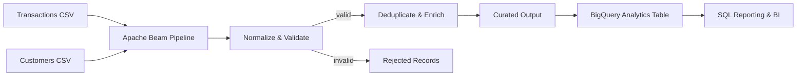

# Enterprise Data Engineering & Cloud Analytics Platform

A portfolio implementation of a multi-source data ingestion and analytics pipeline using Python, Apache Beam, SQL and a BigQuery-ready data model.

> **Implementation status:** This repository contains a runnable local pipeline and BigQuery/Dataflow deployment configuration. The local pipeline is the verified development path. A live GCP deployment is optional and must only be described as completed after you run it in your own GCP project.

## What it demonstrates

- Ingesting records from multiple CSV sources
- Schema normalization and data type conversion
- Data validation with rejected-record handling
- Deduplication using a stable transaction identifier
- Enrichment and derived business fields
- Batch ETL with Apache Beam
- Local execution with the Beam DirectRunner
- BigQuery table schema and analytical SQL
- Unit tests for transformation and validation logic

## Architecture



## Repository structure

```text
.
├── data/
│   ├── customers.csv
│   └── transactions.csv
├── sql/
│   ├── create_tables.sql
│   └── analytics.sql
├── src/
│   ├── __init__.py
│   ├── config.py
│   ├── transforms.py
│   └── pipeline.py
├── tests/
│   ├── __init__.py
│   └── test_transforms.py
├── output/                 # generated locally; ignored by git
├── .gitignore
├── requirements.txt
└── README.md
```

## 1. Set up locally

Use Python 3.10 or 3.11.

```bash
python -m venv .venv
# Windows:
.venv\Scripts\activate
# macOS/Linux:
source .venv/bin/activate

pip install -r requirements.txt
```

## 2. Run the local pipeline

```bash
python -m src.pipeline \
  --transactions data/transactions.csv \
  --customers data/customers.csv \
  --output output/curated_transactions.jsonl \
  --rejects output/rejected_transactions.jsonl
```

The DirectRunner processes the sample data locally. The pipeline writes curated records and rejected records as JSON Lines.

## 3. Run tests

```bash
python -m unittest discover -s tests -v
```

## 4. Query the output

The SQL in `sql/analytics.sql` is written for BigQuery Standard SQL. Create the tables using `sql/create_tables.sql`, load the curated output into the target table, and run the analytical queries.

Example local output fields:

- `transaction_id`
- `customer_id`
- `transaction_ts`
- `amount`
- `currency`
- `country`
- `category`
- `customer_segment`
- `amount_usd`
- `event_date`
- `ingested_at`

## 5. Optional: run on Google Cloud Dataflow

The pipeline supports the Beam DataflowRunner through command-line options. Before using it:

1. Create a GCP project and enable the Dataflow, BigQuery, Cloud Storage and Compute Engine APIs.
2. Create a Cloud Storage bucket in the same region as your Dataflow job.
3. Create the BigQuery dataset and table using the SQL schema.
4. Authenticate with `gcloud auth application-default login`.
5. Install the project dependencies in a compatible environment.
6. Submit the job using the Dataflow options documented below.

Example command (replace every placeholder):

```bash
python -m src.pipeline \
  --runner DataflowRunner \
  --project YOUR_GCP_PROJECT_ID \
  --region YOUR_GCP_REGION \
  --temp_location gs://YOUR_BUCKET/temp \
  --staging_location gs://YOUR_BUCKET/staging \
  --transactions gs://YOUR_BUCKET/input/transactions.csv \
  --customers gs://YOUR_BUCKET/input/customers.csv \
  --output gs://YOUR_BUCKET/output/curated \
  --rejects gs://YOUR_BUCKET/output/rejected \
  --job_name enterprise-data-analytics-demo
```

**Note:** The included pipeline writes JSONL outputs. The BigQuery table schema and SQL are provided for a subsequent load or for extending the pipeline with Beam's BigQueryIO. Do not claim a live Dataflow or BigQuery deployment until you have actually run and verified it.

## Data quality rules

- Required identifiers must be non-empty.
- `amount` must be numeric and non-negative.
- `transaction_ts` must be parseable as an ISO-8601 timestamp.
- Currency is normalized to uppercase.
- Duplicate transaction IDs are removed.
- Invalid rows are written to the rejects output with a reason.

## Engineering decisions

- **Apache Beam:** separates data transformations from the execution engine.
- **DirectRunner:** enables local development and repeatable tests without cloud costs.
- **BigQuery SQL:** provides a warehouse-ready analytical layer.
- **Rejected-record output:** keeps bad input observable rather than silently dropping it.

## Next improvements

- Add Beam BigQueryIO as a direct sink.
- Add schema registry / versioned contracts.
- Add Cloud Composer orchestration and monitoring.
- Add CI with linting, unit tests and integration tests.
- Add partitioning and clustering benchmarks in BigQuery.
